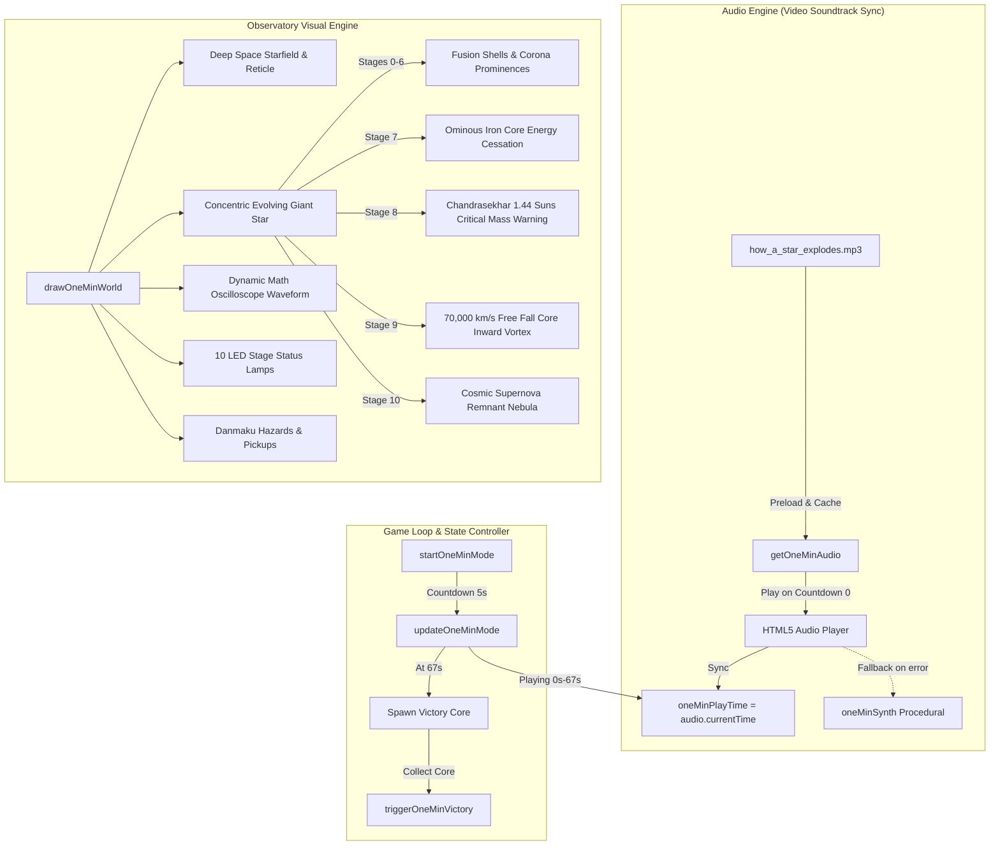

# Technical Architecture & Plan: 1 Mins Mode Visual & Audio Redesign

## 1. System Architecture Overview



---

## 2. Affected Files & Interfaces

| Component | Target File | Nature of Change |
| :--- | :--- | :--- |
| **Audio Asset** | `public/audio/how_a_star_explodes.mp3` | Authentic 67.01s stereo MP3 soundtrack extracted from user's video |
| **Audio Manager** | `public/index.html` | Implement `getOneMinAudio()`, play/pause hooks, `oneMinPlayTime` sync |
| **Visual Renderer** | `public/index.html` (`drawOneMinWorld`) | Complete redesign with Concentric Giant Star, Oscilloscope, and 10 LED Lamps |
| **Stage Hazards** | `public/index.html` (`spawnOneMinStageAttack`) | Align danmaku beat attacks to authentic video tempo and audio cues |
| **State & Flow** | `public/index.html` (`startOneMinMode`, `updateOneMinMode`) | Solidify unblocked countdown, worm movement, and pause/resume safety |
| **CSS Layout** | `public/index.html` (Media Queries & Panels) | Ensure `#panel-onemin` is an isolated modal with zero overlap |

---

## 3. Data Models & Constants

### 3.1 Stage Progression & Timing
```javascript
const ONE_MIN_TOTAL_DURATION = 67.0;
const ONE_MIN_STAGE_DURATION = 6.7; // Exactly 10 stages x 6.7s = 67.0s
```

### 3.2 Visual Star Stages Model
- **Stage 0 (`HYDROGEN`)**: Radius `starMaxR * 0.75`, Cyan/White corona flares, 4 notes per beat arpeggio.
- **Stage 1 (`HELIUM`)**: Radius `starMaxR * 0.70`, Orange/Gold triple-alpha pulse, 3 note chord.
- **Stage 2 (`CARBON`)**: Radius `starMaxR * 0.65`, Amber/Yellow high-density fusion.
- **Stage 3 (`NEON`)**: Radius `starMaxR * 0.60`, Emerald/Violet photodisintegration crossing beams.
- **Stage 4 (`OXYGEN`)**: Radius `starMaxR * 0.55`, Sky Blue neutrino spark discharge.
- **Stage 5 (`SILICON`)**: Radius `starMaxR * 0.50`, Staircase cascade spectrum (`Si -> Fe`).
- **Stage 6 (`IRON`)**: Radius `starMaxR * 0.44`, Dark red/grey dense core, energy loss.
- **Stage 7 (`CHANDRASEKHAR`)**: Core contracts/expands with warning rings (`1.44 M☉`).
- **Stage 8 (`COLLAPSE`)**: Radius plunges to 0.15, inward gravitational vortex streaks at 70,000 km/s.
- **Stage 9 (`SUPERNOVA`)**: Shockwave blast wave expands with `t^(2/5)`, multi-layer prismatic nebula clouds.
